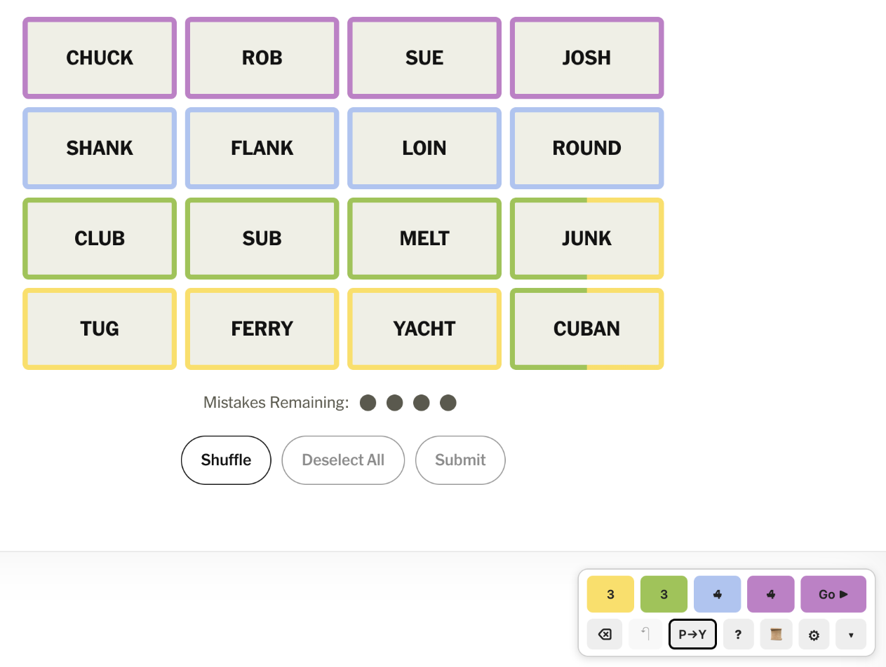
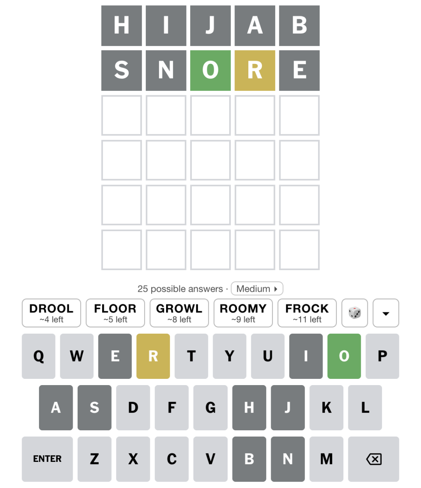
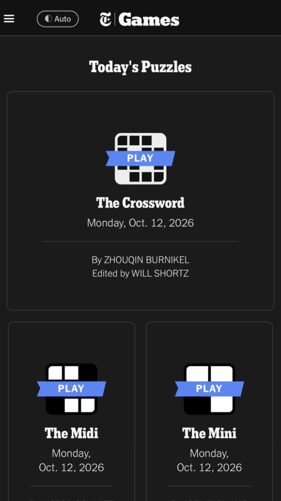

<h1>games-scripts</h1>

Userscripts for browser word and puzzle games. Each one adds features to the game's own page, on desktop and on phones and tablets (iPhone, iPad and Android).

## Scripts

| Script | What it does | Install |
| --- | --- | --- |
| [**Connections Palette**](connections/README.md) | NYT Connections: color-code the tiles as you work out the groups, with each color in its own row, then submit the groups in the order you choose (purple first for a reverse rainbow). | [Greasy Fork](https://greasyfork.org/en/scripts/599362-connections-color-marker) · [GitHub](https://raw.githubusercontent.com/dividedby/games-scripts/main/connections/connections-color-marker.user.js) |
| [**Wordle Shortlist**](wordle/README.md) | NYT Wordle, for people who'd rather not do all of Wordle: a random starting word, then a shortlist of five possible answers each turn. Easy, but you still make the call. | [Greasy Fork](https://greasyfork.org/en/scripts/599505-wordle-shortlist) · [GitHub](https://raw.githubusercontent.com/dividedby/games-scripts/main/wordle/wordle-shortlist.user.js) |
| [**NYT Games Dark**](nyt-dark/README.md) | A real dark mode for NYT Games in the browser, using NYT's own dark colors, so Connections' blue doesn't turn gray like it does with dark-mode extensions. Follows your device, or set it to always dark or light. | [Greasy Fork](https://greasyfork.org/en/scripts/599796-nyt-games-dark) · [GitHub](https://raw.githubusercontent.com/dividedby/games-scripts/main/nyt-dark/nyt-games-dark.user.js) |
| [**Minute Cryptic Plus**](minute-cryptic/README.md) | Minute Cryptic on a phone: your own keyboard instead of the game's, and a quicker scribble space (shuffle the letters right in the boxes, a circle in one tap, and back into the boxes). | [GitHub](https://raw.githubusercontent.com/dividedby/games-scripts/main/minute-cryptic/minute-cryptic-plus.user.js) |

<p align="center">
  <a href="connections/README.md"></a>
  &nbsp;
  <a href="wordle/README.md"></a>
  &nbsp;
  <a href="nyt-dark/README.md"></a>
</p>

## Installing

1. Get a userscript manager for your browser:

   | Browser | Userscript manager |
   | --- | --- |
   | Chrome, Edge, Brave and other Chromium browsers | [Tampermonkey](https://www.tampermonkey.net/). In Chrome, also turn on **Allow user scripts** on Tampermonkey's details page (Extensions → Details). |
   | Firefox, on desktop or Android | [Tampermonkey](https://addons.mozilla.org/firefox/addon/tampermonkey/) or [Violentmonkey](https://addons.mozilla.org/firefox/addon/violentmonkey/) |
   | Safari on iPhone, iPad or Mac | The [Userscripts](https://apps.apple.com/app/userscripts/id1463298887) app |

   On Android, use Firefox: Chrome for Android doesn't support extensions.
2. Install a script from either link in the table. Both have the same version:
   - **Greasy Fork**: click **Install this script**. This is the easiest option, and it's where reviews and questions go.
   - **GitHub**: open the link and your userscript manager offers to install it. New versions show up here first.
3. Updates come from wherever you installed the script. Tampermonkey and Violentmonkey check for them on their own; in the Userscripts app, use its update check. Install each script from just one place, or it will run twice.

## Development

No build step: each `*.user.js` file is the script itself. Tests run each script against a simulated copy of its game:

```sh
pnpm install
pnpm test
```

Changes are listed in the [changelog](CHANGELOG.md). Bugs and ideas go in the [issues](https://github.com/dividedby/games-scripts/issues).

## License

GPL-3.0-or-later. See [LICENSE](LICENSE).
