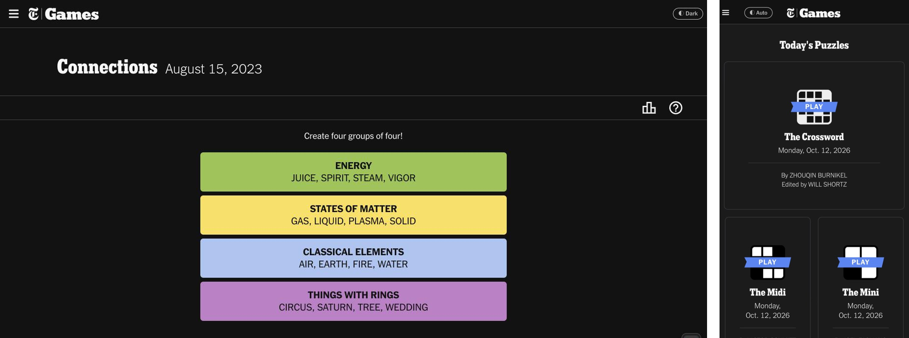
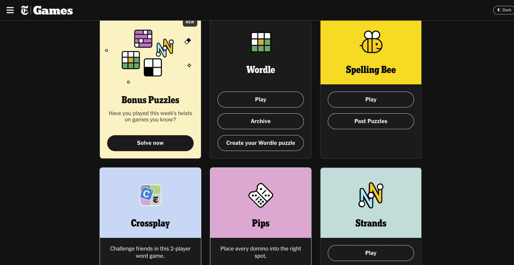

# NYT Games Dark

A proper dark mode for NYT Games in the browser.

The NYT Games app has a dark mode; the website doesn't, so on the web you're stuck with a bright page or a dark-mode extension like Dark Reader or Noir. Those extensions guess at every color, and puzzle colors suffer: in Connections, the blue group ends up the same gray as an unsolved tile.

It turns out the website already ships NYT's dark colors for the games themselves (the same ones the app uses). It just never switches them on. This script does, so game colors stay exactly as NYT designed them. The older parts of the site never got dark colors (the top bar, the ☰ menu, start screens, the home page, the archives), so the script darkens those itself.

<p align="center">
  
</p>

**Install:** [Greasy Fork](https://greasyfork.org/en/scripts/599796-nyt-games-dark) · [GitHub](https://raw.githubusercontent.com/dividedby/games-scripts/main/nyt-dark/nyt-games-dark.user.js) · [Changelog](../CHANGELOG.md#nyt-games-dark)

## How it works

1. Install the script (see [Installing](../README.md#installing)) and open any NYT game.
2. By default it follows your device: dark when your phone or computer is in dark mode, light otherwise.
3. Tap **◐ Auto** in the top bar, next to the Games logo (in Wordle, next to ⚙ once you're past the start screen; just **◐** on a phone), to switch between **Auto**, **Dark** (always) and **Light** (always). Your choice is remembered across the games.

**Using a dark-mode extension?** Dark Reader steps aside on its own: the script tells it the page is already dark. Noir (Safari on iPhone and iPad) doesn't, so turn Noir off for nytimes.com (and help.nytimes.com), or the page gets darkened twice and the colors go off again.

## What's covered

- **Every game**: Connections, Wordle, Strands, Spelling Bee, the Crossword, Midi and Mini, Letter Boxed, Tiles, Sudoku, Pips and the bonus puzzles, with their menus, pop-ups (How to Play, settings, stats, hints) and results screens. Game colors stay NYT's own. (Wordle also has its own Dark Theme in its settings; either works.)
- **The ☰ menu, the top bar and start screens.** Colorful start screens (Connections' purple, for example) keep their color; plain white or gray ones turn dark.
- **The Games home page, archives, stats and the footer**: white cards and panels turn dark; colorful game cards keep their color.

<p align="center">
  
</p>

- **Hints and bots**: the Connections Companion, Spelling Bee Forum, Wordle Review and Wordplay pages (comments included), Wordle Bot and Connections Bot, and the NYT Help Center.
- **The crossword grid**: dark squares with light letters, the current word in deep blue and the selected square still yellow, like the NYT app.

## Development

The script is a single file, [`nyt-games-dark.user.js`](nyt-games-dark.user.js), with no build step. Behavior tests run it in jsdom ([`test/`](test/)):

```sh
pnpm install
pnpm test
```

Report bugs and pages that still look wrong in the [issues](https://github.com/dividedby/games-scripts/issues).
